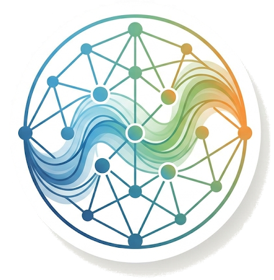
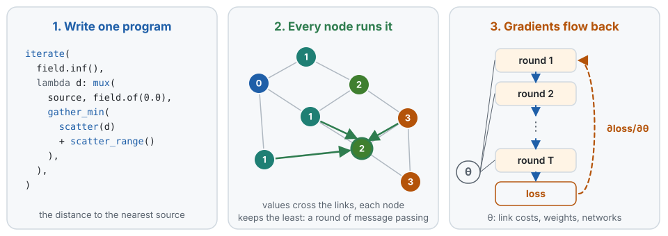
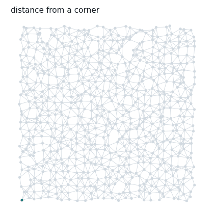
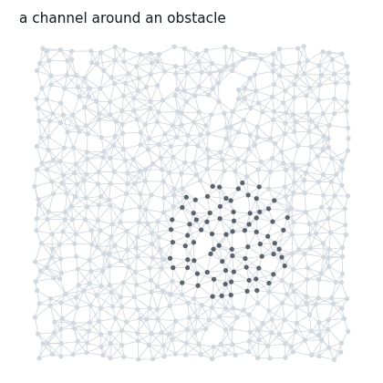
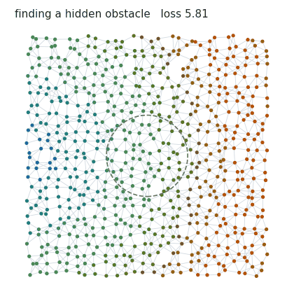

<div align="center">



# DifField

Differentiable field programming for self-organising systems, on PyTorch.

[](https://github.com/cric96/differentiable-field-calculus/actions/workflows/ci.yml)
[](pyproject.toml)
[](https://pyg.org)
[](https://github.com/astral-sh/ruff)
[](https://www.conventionalcommits.org/en/v1.0.0/)

**[Writing programs](docs/programs.md)** ·
**[Simulation](docs/simulation.md)** ·
**[Decentralized execution](docs/decentralized.md)** ·
**[Architecture](docs/architecture.md)** ·
**[Experiments](examples/README.md)**

</div>

---

You write **one program** for a whole network, with a handful of field operations
(`iterate`, `scatter`, `gather`, `branch`, `mux`). Every node runs it in rounds,
exchanging values with its neighbours, and since the rounds are PyTorch operations a
loss on the result reaches every parameter of the program, through every round.

<p align="center">
  <picture>
    <source media="(prefers-color-scheme: dark)" srcset="docs/assets/program-dark.svg">
    
  </picture>
</p>

<table align="center"><tr>
  <td align="center" width="33%">
    <picture>
      <source media="(prefers-color-scheme: dark)" srcset="docs/assets/wave-dark.gif">
      
    </picture>
    <br><sub><b>Gradient</b>: the distance from a corner</sub>
  </td>
  <td align="center" width="33%">
    <picture>
      <source media="(prefers-color-scheme: dark)" srcset="docs/assets/channel-dark.gif">
      
    </picture>
    <br><sub><b>Channel</b>: the shortest way around an obstacle</sub>
  </td>
  <td align="center" width="33%">
    <picture>
      <source media="(prefers-color-scheme: dark)" srcset="docs/assets/learning-dark.gif">
      
    </picture>
    <br><sub><b>Learning</b>: costs learnt from distances find a hidden obstacle</sub>
  </td>
</tr></table>

## Installation

Requires [uv](https://github.com/astral-sh/uv) and Python 3.12+. Pick the extra that
matches your hardware:

```bash
uv sync --extra cpu                    # CPU
uv sync --extra cuda                   # NVIDIA GPU
uv sync --extra cpu --extra decentralized   # also run programs device by device, on Mesa
```

## A taste

The distance of every node from a source, the "hello world" of field programming:

```python
from diffield.dsl import field, gather_min, iterate, mux, scatter, scatter_range
from diffield.sim import GridScenario, SimulationEngine

def program(runtime):
    source = runtime.signals["source"]
    return iterate(
        field.inf(),
        lambda d: mux(source, field.of(0.0), gather_min(scatter(d) + scatter_range())),
        name="dist",
    )

scenario = GridScenario(10, 10, connectivity=4)
engine = SimulationEngine.from_scenario(scenario)
output, runtime = engine.run(rounds=20, program=program, signals={"source": scenario.marker(0, 0)})
```

- `iterate` keeps a field `d` across rounds, starting from infinity everywhere;
- `scatter(d) + scatter_range()` puts on each link the distance through that neighbour;
- `gather_min` keeps, at each node, the shortest of the links that reach it;
- `mux` holds the source at zero.

After 20 rounds `output` holds each node's hop distance from the corner. Put a
parameter in the program (a cost per node, a weight per link, a network) and
`loss.backward()` trains it: [Writing programs](docs/programs.md#learning-through-a-program)
shows how, and what else the language offers.

## What's inside

- **Language** (`diffield.dsl`): the primitives, link fields and the building blocks
  of aggregate computing (`gradient`, `broadcast`, `collect_cast`, `elect`, …), exact in
  hard mode and smooth in soft mode. [Writing programs](docs/programs.md)
- **Simulation** (`diffield.sim`): grid and spatial scenarios, moving devices, events
  and recording. [Simulation](docs/simulation.md)
- **Decentralized execution** (`diffield.decentralized`): the same program, one device
  at a time on Mesa, node for node equal to the batched run.
  [Decentralized execution](docs/decentralized.md)
- **Experiments** (`examples/`): distance fields, channels, Boids, the SEAMS campaigns
  and VMAS controllers, on their way to a repository of their own.
  [Experiments](examples/README.md)

## Development

```bash
uv sync --extra cpu --extra decentralized
uv run pytest tests        # the library; `uv run pytest examples` for the experiments
uv run ruff check .
uv run pyright
uvx pre-commit install     # run them before each commit
```

The rules of the project (test-driven development, Conventional Commits, the Python
style) are in [CLAUDE.md](CLAUDE.md), and the tests are described in
[docs/testing.md](docs/testing.md). The figures are drawn by `docs/assets/diagrams.py`
and the animations rendered by `docs/assets/animations.py`.
