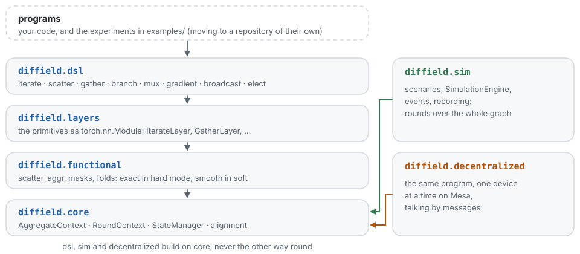
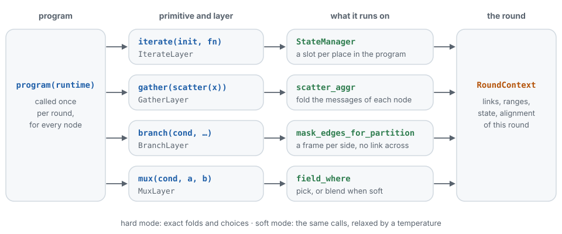
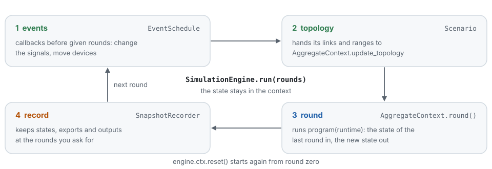
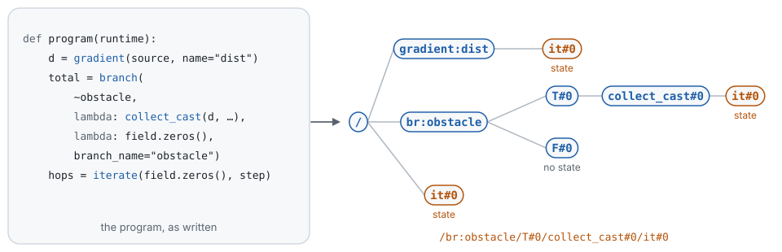

# Architecture

How DifField is put together. A program is a Python function over fields: every
primitive it calls is a `torch.nn.Module` over a tensor operation, a context holds the
graph and the state of the program, and an engine runs the rounds. What a program can
use is in [Writing programs](programs.md); running it is in [Simulation](simulation.md)
and [Decentralized execution](decentralized.md).

## Packages

  <picture>
    <source media="(prefers-color-scheme: dark)" srcset="assets/architecture-dark.svg">
    
  </picture>

| Package | What it holds |
|---------|---------------|
| `diffield.dsl` | The primitives and the building blocks a program is written with |
| `diffield.layers` | Each primitive as a `torch.nn.Module` |
| `diffield.functional` | The tensor operations under them: folds, masks, conditionals |
| `diffield.core` | The contexts of a round, the state, the alignment, the hard and soft modes |
| `diffield.sim` | Scenarios, the engine, events and recording |
| `diffield.decentralized` | The same program on independent devices |

## Inside a round

  <picture>
    <source media="(prefers-color-scheme: dark)" srcset="assets/inside-round-dark.svg">
    
  </picture>

The program is called once per round, for all the nodes at once. A node field is a
tensor of shape `[N, ...]` and a link field one of shape `[E, ...]`. Every primitive
works on the current `RoundContext`, which holds the links of the round, their lengths
and the state:

- **`iterate`** reads its slot of the `StateManager` and writes it back.
- **`gather`** folds a link field into a node field with `scatter_aggr`.
- **`branch`** masks the links between its two partitions, and gives each side a
  frame of its own.
- **`mux`** picks node by node with `field_where`.

In hard mode the folds and the choices are exact; in soft mode the same calls relax
them, with a temperature (see [Hard and soft](programs.md#hard-and-soft)).

## Across rounds

  <picture>
    <source media="(prefers-color-scheme: dark)" srcset="assets/across-rounds-dark.svg">
    
  </picture>

`AggregateContext` is what lives from one round to the next: the graph and the
`StateManager`. `update_topology` swaps the links in place between rounds, while the
nodes and their state stay, so on a moving network the stateful fields (`gradient`,
`elect`, `iterate`) heal instead of starting over. Link lengths taken from positions
are detached: a routing cost is structure, not a gradient path. `SimulationEngine`
drives the loop; `step` runs a single round, for loops of your own.

## Alignment

  <picture>
    <source media="(prefers-color-scheme: dark)" srcset="assets/alignment-dark.svg">
    
  </picture>

The state of a program belongs to a place in its *evaluation tree*, not to a line of
its source. A place is named by the path from the root, one token per construct:
`kind#index`, or `kind:label` when it is named. `index` counts the occurrences of that
kind in the current frame, so two calls to the same block never share their state:
that is what lets blocks stack. A path holds no file name, line or object id, so it is
the same in every process, in a checkpoint, and on the wire.

- `iterate` and `gather` add a token; `iterate` also opens a frame, so what runs inside
  its body nests below it.
- `branch` opens a `T` and an `F` frame. Once both sides have run, the slots of each
  side are kept only on its own nodes, so a node that changes side starts that side's
  state from its initial value.
- `mux` adds nothing: both of its arms run in the caller's frame.
- `@aggregate` opens a frame for a function, as the building blocks do. Counters
  already keep calls apart; the frame keeps the paths readable and stable when the
  code around them changes.
- `name=` labels a place. A labelled token has no index, so a new call beside it never
  renames its slot. A lookup takes a full path or a bare label, and a label that
  matches two slots (the same name on both sides of a `branch`) raises.

## Local execution

The same program also runs on a single device. `DeviceContext` holds one device and
its neighbours; `DeviceRuntime`, in `diffield.decentralized`, gives each device its own
context, which exchanges its state with the neighbours as messages. In synchronous mode,
a program that respects the causality conditions of
[Decentralized execution](decentralized.md) gives the same field as the batched engine.

`DeviceContext` on its own is a view for debugging: its neighbours have no links of
their own, so a program is reproducible there only if every `gather` reads a sensor, a
constant, or the state of an `iterate` from the previous round. `mid()` numbers the
local view unless `device_id` and `neighbor_ids` give the real ids.

## Design decisions

1. **PyTorch throughout.** Every operation is differentiable, so a whole run can be
   optimized end to end.
2. **Hard and soft.** Every primitive has an exact and a relaxed mode, chosen with
   `with_mode` or `mode=` and `tau=`.
3. **Rounds.** Computation advances in discrete rounds, which carry the state and let
   the topology change between them.
4. **Topology apart from programs.** A scenario owns the graph; the same program runs on
   any of them, batched or device by device.
5. **Events outside the program.** An `EventSchedule` changes the world between rounds,
   without touching the program.
6. **Isolation by `branch`.** The two sides of a `branch` do not talk to each other,
   which partitions the network in space.
