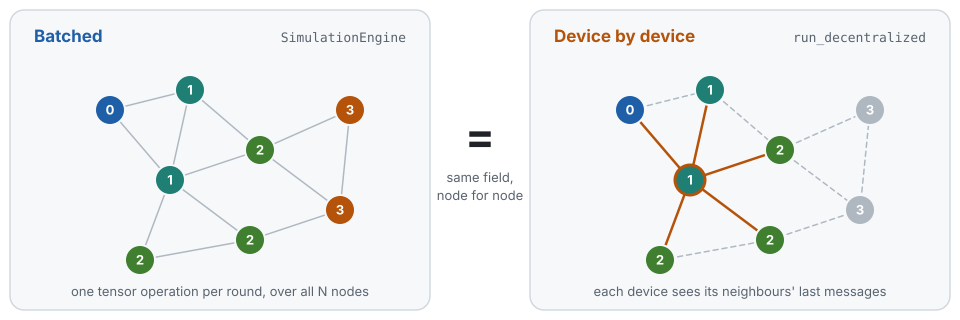

# Decentralized execution

The [simulation](simulation.md) evaluates a round as one batched operation over the
whole graph. The same program can also run **the way the model says it should be
executable**: one device at a time, each seeing only its neighbours' messages, inside
[Mesa](https://mesa.readthedocs.io), a general-purpose agent-based modelling framework
that knows nothing about field calculus.

<p align="center">
  <picture>
    <source media="(prefers-color-scheme: dark)" srcset="assets/execution-dark.svg">
    
  </picture>
</p>

```bash
uv sync --extra cpu --extra decentralized
```

```python
import torch

from diffield.decentralized import run_decentralized
from diffield.dsl import gradient

# Everything the program needs comes from `runtime.signals`: centrally those are
# global [N] fields, on a device they are that device's local [1 + k] view.
def program(runtime):
    return gradient(runtime.signals["source"], name="dist")

central, _ = engine.run(rounds=20, program=program, signals=signals)
local = run_decentralized(scenario=scenario, program=program, signals=signals, rounds=20)

assert torch.equal(central, local.final)
```

A device's outbound message is its `iterate` state table keyed by **alignment path**, and
its neighbours' sensor readings travel with it — `branch` keeps a link only when both of
its endpoints are in the partition, so a device cannot mask its own in-edges without them.

`mode="sync"` (default) puts a barrier between rounds. For programs satisfying the
causality conditions below it reproduces the batched run node for node.
`mode="async"` drops the barrier: devices are
shuffled, publish as they go, and may skip rounds with probability `1 - activation_prob`.

## Running the comparison

`examples/decentralized/channel_obstacles.py` runs the channel-with-obstacles program
both ways in a single invocation — centrally through `SimulationEngine`, then device by
device through Mesa — and diffs them round by round.

```bash
# synchronous: expect 0 mismatched nodes on every round
uv run --extra cpu --extra decentralized \
    python examples/decentralized/channel_obstacles.py --rows 12 --cols 12 --rounds 40

# asynchronous: expect a divergent transient, identical fixed point
uv run --extra cpu --extra decentralized \
    python examples/decentralized/channel_obstacles.py --rows 12 --cols 12 --rounds 40 --async
```

Figures land in `generated/decentralized_channel_*.png`: centralized field, decentralized
field, and their difference, plus a convergence curve in async mode. Useful flags:
`--tolerance` (channel width), `--activation-prob` (async duty cycle), `--seed`, `--no-viz`.

```bash
uv run --extra cpu --extra decentralized pytest tests/decentralized -v
```

## Moving devices

Devices may move. Pass the same `EventSchedule` both runs take; when a callback moves the
nodes, each affected device's star graph is rebuilt at its new degree and carries its own
state across, so the two runs still agree node for node while links form and break.

```python
def drift(runtime):
    runtime.scenario.step_positions(runtime.metadata["velocities"])

schedule = EventSchedule([ScheduledEvent(round_idx=i, callback=drift) for i in range(rounds)])

engine.run(rounds=rounds, program=program, signals=signals,
           metadata={"velocities": velocities}, schedule=schedule)
run_decentralized(scenario=scenario, program=program, signals=signals, rounds=rounds,
                  metadata={"velocities": velocities}, schedule=schedule)
```

`result.retopologized_rounds` lists the rounds in which some device's neighbour set changed.
Let the devices slow to a halt and the field re-converges on the true shortest-path metric
of wherever they ended up — `tests/decentralized/test_moving_devices.py` checks that against
a NetworkX Dijkstra.

`examples/decentralized/moving_devices.py` animates it: devices drift at full speed, then
slow to a halt, while the field they are computing keeps up.

```bash
uv run --extra cpu --extra decentralized \
    python examples/decentralized/moving_devices.py                  # GIF
uv run --extra cpu --extra decentralized \
    python examples/decentralized/moving_devices.py --format mp4     # needs ffmpeg
uv run --extra cpu --extra decentralized \
    python examples/decentralized/moving_devices.py --async --rounds 160
```

The left panel is the live network, nodes coloured by their distance to the source and links
redrawn every round; the right panel tracks the mean distance for both executions against the
true metric of the final layout. The run reports how many rounds rewired someone's
neighbourhood, when the devices parked, and how far the field ended from that true metric.

Two honest caveats it will tell you about. Re-convergence after a link breaks is slow — a
distance has to *grow*, and a min-based gradient raises it a step at a time rather than a hop
per round, so give it rounds after the devices park. And a group of devices cut off from the
source entirely will sit on stale finite estimates that climb very slowly rather than jumping
to infinity: that is count-to-infinity, a property of the program and not of decentralization,
which is why both executions do it identically.

## Limits

Reproducible only for programs whose every `gather` scatters a sensor, a
constant, or a previous-round `iterate` state — the condition documented on `DeviceContext`.
It holds for `gradient`, `gradient_cast`, `broadcast` and the channel, subject to
causal initializers and locally computable payload transformations. `branch`
conditions must likewise be sensors or previous-round state. The legacy default
`collect_cast` reconstructs parent choices globally and is **not** equivalent on
independent devices. Use `collect_cast(..., mode="hard", causal=True)` on symmetric
networks: each device publishes its potential, stable-ID parent choice and payload;
receivers accept previously published nominations. Initialization assumes no remote
contributions, adding potential/parent publication latency before collection.
`causal=True, mode="soft"` is explicitly unsupported. A changing tree can temporarily
omit or duplicate contributions; conservation is checked after convergence.
