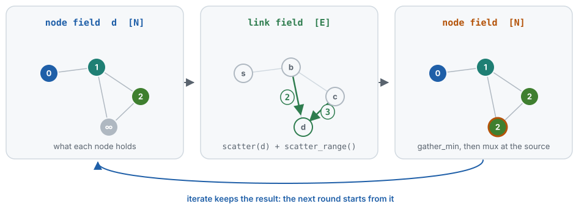

# Writing programs

A DifField program is a Python function that every node of a graph runs at once, in
rounds. It reads **fields** (a tensor with one row per node, `[N, ...]`) and talks to
the neighbours through **link fields** (one value per directed link, `[E, ...]`). All
of it is PyTorch, so a loss computed on the result reaches every parameter the
program used, through every round.

## One round

<p align="center">
  <picture>
    <source media="(prefers-color-scheme: dark)" srcset="assets/round-dark.svg">
    
  </picture>
</p>

The distance from a source, the "hello world" of aggregate computing, shows the whole
cycle:

```python
from diffield.dsl import field, gather_min, iterate, mux, scatter, scatter_range

def program(runtime):
    source = runtime.signals["source"]
    return iterate(
        field.inf(),
        lambda d: mux(source, field.of(0.0), gather_min(scatter(d) + scatter_range())),
        name="dist",
    )
```

- `iterate(init, fn)` keeps a field across rounds: it starts as `init` and becomes
  `fn(previous)` at every round.
- `scatter(d)` sends each node's value along its outgoing links, a link field;
  `scatter_range()` is the length of each link, so the sum is the distance through
  that neighbour.
- `gather_min(...)` folds the links that reach a node into one value: the shortest.
- `mux(source, a, b)` picks `a` where `source` holds, `b` elsewhere.

## Primitives

| Primitive | What it does |
|-----------|--------------|
| `iterate(init, fn, name=...)` | State of each node across rounds |
| `scatter(value)` | A link field: the value of the sender, on each link |
| `nbr(value)` | The neighbours' value from their previous round (field-calculus `nbr`) |
| `scatter_range()` | The length of each link (1 on hop-count graphs) |
| `gather(expr, aggr)`, `gather_min` / `_max` / `_sum` / `_avg` | Fold a link field into a field |
| `branch(cond, if_true, if_false)` | Split the network: each side runs its own computation and only talks to itself |
| `mux(cond, if_true, if_false)` | Choose node by node, without splitting the network |
| `aligned_on(key)` | Partition the enclosed block by a key (ScaFi `align`, FCPP `split`) |
| `mid()` | The identity of each node |

Link fields support arithmetic, comparisons, `&` and `|`, `abs()`, `norm()`, and
`link_map(fn, ...)` / `link_cat([...])` for anything else, so
`gather_sum(scatter(x) * w)` or `gather(scatter(x) + scatter_range(), aggr="min")`
read as they compute. Fields are tensors, built with the `field` helpers or taken from
the scenario:

```python
from diffield.dsl import field

field.of(0.0)   # a constant field
field.zeros()   # zeros, ones, infinities
field.ones()
field.inf()
```

## Building blocks

Written with the primitives, in `diffield.dsl`:

| Block | What it does |
|-------|--------------|
| `gradient(source)` | Distance from the source nodes along the cheapest path (also `distance`, `distance_to`) |
| `broadcast(mask, value)` | Spread the value of the root nodes through the network |
| `gradient_cast(source, center, accumulation)` | Carry a payload outward along a gradient |
| `collect_cast(potential, local, null, accumulation)` | Collect payloads toward the minima of a potential |
| `converge_cast(potential, local)` | Accumulate values toward the minima of a potential (ScaFi `C`) |
| `elect(key, eligible, grain=...)` | Leader election, the *S* block; returns the leaders and the key each node adopts |
| `bounded_election(strength, radius)`, `follow(election, value)` | Regions around elected leaders, and reading a value of one's region |
| `descend(potential, toward)` | A soft steepest-descent direction on a potential |
| `nbr_count()`, `has_neighbors()` | Degree of each node, as a number or a flag |

`gradient`, `gradient_cast`, `broadcast`, `collect_cast` and `elect` take an optional
`weight`, a link field, when the cost of a link is not its range:
`gradient(source, weight=scatter(cost) + scatter_range())`; `converge_cast` and
`bounded_election` take it as `metric`.

## Hard and soft

Every primitive has two modes. **Hard** is exact: `gather_min` is a minimum, `branch`
splits the network, `mux` picks. **Soft** relaxes the discrete choices into smooth
ones (a log-sum-exp minimum, weighted selections) so that gradients also reach what
the hard choice discarded. Hard mode is still differentiable wherever the choice is,
which is enough to learn link costs or weights, as below.

```python
from diffield import with_mode

with with_mode("soft", tau=0.1):   # tau: temperature of the relaxed folds, lower is sharper
    output, _ = engine.run(rounds=20, program=program, signals=signals)
```

The folds, `mux`, `branch` and the blocks also take `mode=` (and `tau=`) for a single
occurrence. In soft mode, start an `iterate` from a large finite value rather than
`field.inf()`: a weighted mix with infinity stays infinite, and the distance program
above, started from `field.of(100.0)`, converges to `0.01, 1.01, 1.99, …` instead.

## Learning through a program

Anything a program reads can be a parameter: a cost per node, a weight per link, a
`torch.nn.Module` called inside `iterate`. Run the rounds, compute a loss, and call
`backward`; here with the `scenario` and the `engine` of the [README](../README.md#a-taste):

```python
import torch

cost = torch.zeros(scenario.num_nodes, requires_grad=True)   # what crossing a node costs
optimizer = torch.optim.Adam([cost], lr=0.1)

def program(runtime):
    source = runtime.signals["source"]
    return iterate(
        field.inf(),
        lambda d: mux(source, field.of(0.0), gather_min(scatter(d + cost) + scatter_range())),
        name="dist",
    )

for epoch in range(100):
    engine.ctx.reset()   # every epoch starts from round zero
    output, _ = engine.run(rounds=20, program=program, signals={"source": source})
    loss = (output - measured).pow(2).mean()   # measured: the distances observed
    optimizer.zero_grad()
    loss.backward()   # through every round, back to cost
    optimizer.step()
```

The [learning animation](../README.md) is this program on a deformed lattice: the costs
it learns from distances alone outline an obstacle that the data never names.

## Naming and alignment

The state of an `iterate`, and of every block built on it, belongs to its place in the
program: two calls on the same line, or in the two sides of a `branch`, never share it.
`name=` labels a place, so that its state has a readable key (`/it:dist`) that stays
the same when the program around it changes. The
[architecture](architecture.md#alignment) explains how places are identified.
